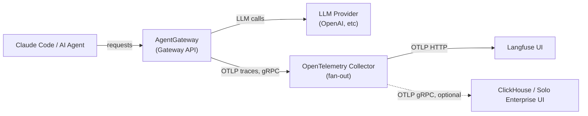

# Setting up Langfuse

https://greptime.com/blogs/2026-05-09-opentelemetry-genai-semantic-conventions
This one is going to be a doozy.
I just want to save my chat history in a centralized database.

There are several promising OTEL libraries for agent harnesses
https://github.com/openlit/openlit
https://github.com/traceloop/openllmetry
https://github.com/langfuse/langfuse

But I want one that can seamlessly connect with AgentGateway using the open `gen_ai.*` schema convention.
For now, we'll go with the most popular option LangFuse.

# Installing LangFuse
https://www.solo.io/blog/llm-observability-agentgateway-langfuse



1. Add Helm repository
```bash
helm repo add langfuse https://langfuse.github.io/langfuse-k8s
helm repo update
```


2. Configure `values.yaml`
Since I'm deploying this locally on a virtualized k3s cluster, I just want a minimal setup that's not too hard on resources.
By default, the helm chart will deploy the full [langfuse architecture](https://langfuse.com/self-hosting#architecture). This means, it will deploy its own PostgreSQL, Redis cache, ClickHouse, S3 bucket alongside its application containers.
We can use the [minimal example](https://github.com/langfuse/langfuse-k8s/tree/main/examples/minimal-installation). The minimal example requires both cert-manager and clickhouse-operator to be up-and-running.


https://langfuse.com/self-hosting/deployment/kubernetes-helm


3. Configure AgentGateway->Langfuse otel pipeline
https://www.solo.io/blog/llm-observability-agentgateway-langfuse


<!-- ## Installing OpenLIT
For now, we'll go with OpenLIT. Let's follow the [instructions](https://docs.openlit.io/latest/openlit/installation#kubernetes) for deploying to our Kubernetes cluster.
```bash
helm repo add openlit https://openlit.github.io/helm/
helm repo update
helm install openlit openlit/openlit
``` -->

# Installing Phoenix
The problem with Langfuse is that it's a huge multi-component deployment. I just want something lighter.
Since AgentGateway can emit OTLP output, we should be able to swap out Langfuse with Arize Phoenix
